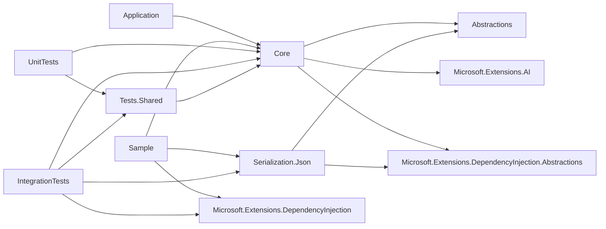
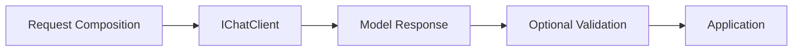
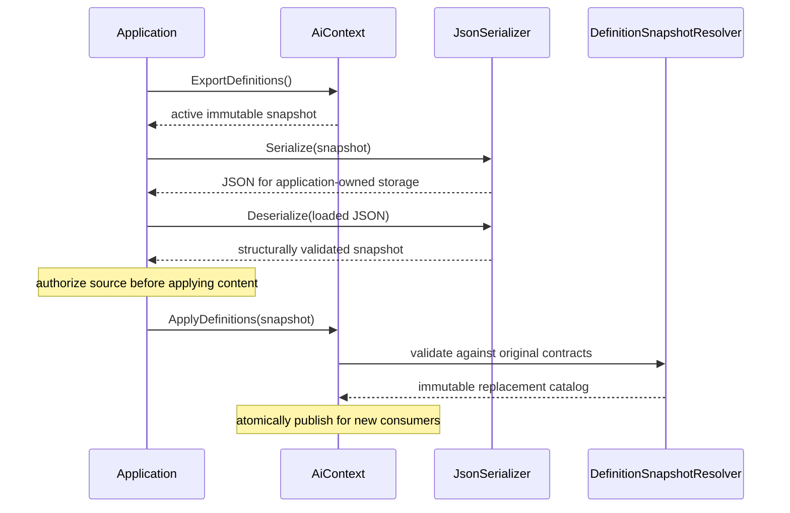
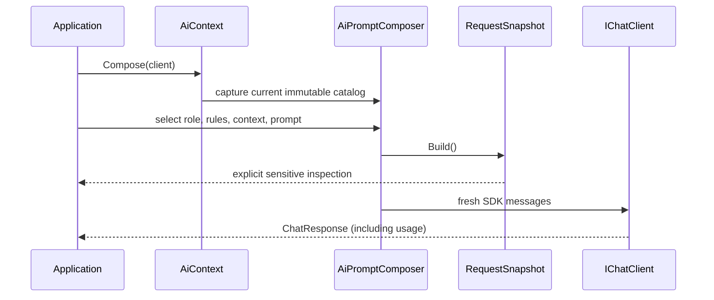
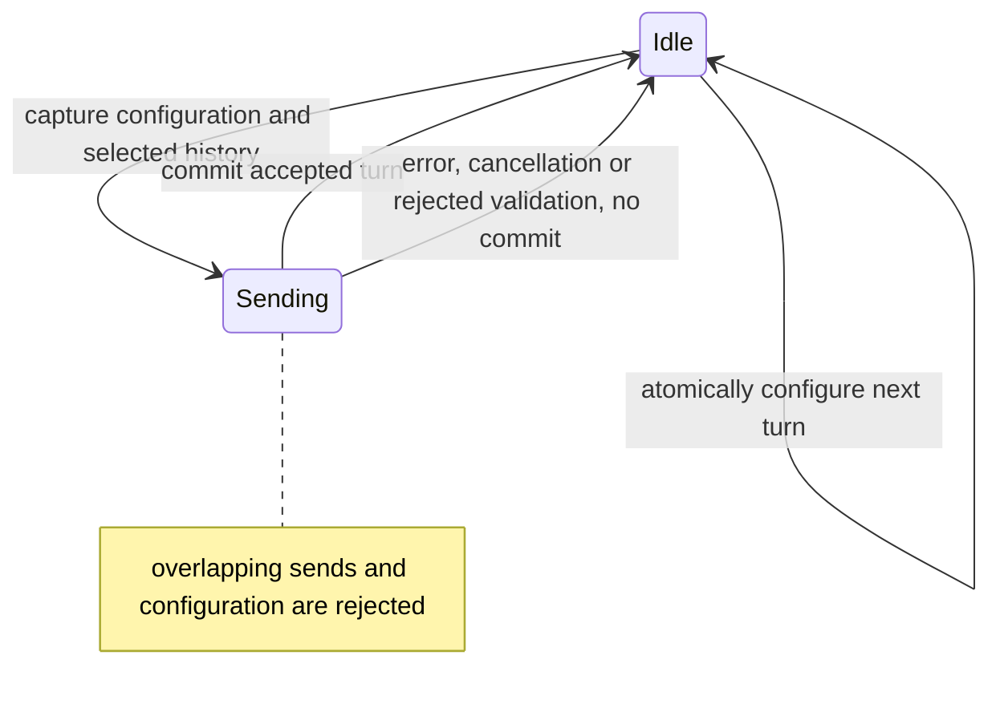
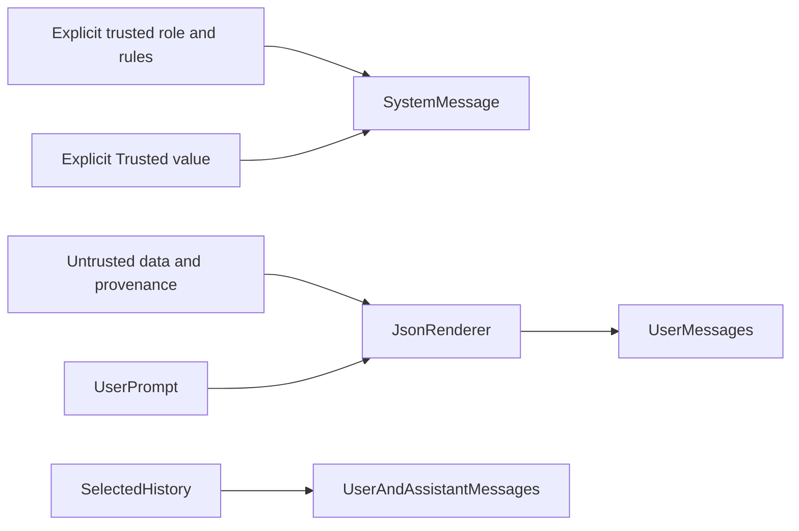
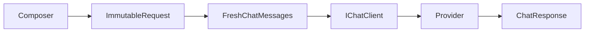

# Architecture

The EF Core analogy applies to discoverable domain definitions and configuration builders only. An AiContext is a reusable catalog with lazy registration and an atomically replaceable active content snapshot, never a Unit of Work. Registered definition objects hold immutable compiled defaults and define the application's contracts. Each published DefinitionCatalog and its declarative content are immutable. Registration uses object identity so unrelated domain definitions cannot be selected accidentally; generic selection requires exactly one registered definition assignable to the requested type.

Abstractions owns definition models, trust values, request/history snapshots, portable definition snapshots, IAiDefinitionSerializer and the rendering/history strategy contracts. Core owns registration, definition-contract resolution and publication, composition, execution and runtime conversation transitions. Optional Serialization.Json implements strict JSON serialization and its own DI registration; Core has no reference to that module or any storage implementation. Abstractions has no package or project dependencies. Feature namespaces mirror folders. The graph shows project references and direct production package dependencies; test-runner packages are omitted.

Result contracts, validator interfaces and validation outcomes also live in Abstractions. Core's scoped AiValidationPipeline resolves required validator services and evaluates them sequentially. RequestExecutor coordinates SDK parsing and optional domain evaluation after receiving a response. AiContext remains a catalog; composition does not evaluate domain correctness. See [Result validation](LLD/ResultValidation.md) for lifecycle and status semantics.

The explicit Expect/SendValidatedAsync path returns structural diagnostics separately from domain findings. Invalid, Unverifiable and structurally failed candidates do not commit conversation turns; callers retain the attempted request and raw text for their own audit. Accepted turns store immutable domain findings, while legacy turns default to NotValidated. Validation failures never trigger another model call. Passing configured checks establishes neither universal truth nor business-action authorization.

| Component | Responsibility | Lifetime and dependencies |
| --- | --- | --- |
| AiContext / DefinitionCatalog | Register typed contracts, expose active content and publish validated replacements | Reusable; lazy registration and immutable catalog snapshots; singleton with AddAiContext |
| AiContextBuilder | Validate registration and publish a detached catalog | Initialization only |
| DefinitionSnapshotResolver | Validate complete content against the original registered contracts | Internal; preserves registered objects and contract identity |
| IAiDefinitionSerializer / JsonAiDefinitionSerializer | Serialize and validate portable declarative content | Optional stateless JSON adapter; singleton with AddAiComJsonSerialization; application owns storage |
| DefinitionSelection | Validate explicit selections and conflicts | Internal immutable value shared by builders |
| AiPromptComposer | Render one selected request | Local mutable builder; renderer and SDK executor |
| AiTypedRequest / AiResultContract | Capture a composed request and immutable validator selections | Expect captures the request immediately; no later composer changes are adopted |
| AiRequestConfiguration | Expose request-local selection and context overrides without execution access | Conversation callback only; delegates to the local composer |
| RequestExecutor | Convert immutable messages and invoke the SDK | Internal provider boundary; no history ownership |
| AiValidationPipeline | Resolve selected validators before dispatch and evaluate domain findings after parsing | Scoped DI service; registered validators are scoped and run sequentially |
| ConversationConfigurationBuilder | Transactionally change selections, switch domains or refresh captured definitions | Operation-local callback builder; publishes only after successful configuration |
| AiConversation | Coordinate transitions and successful-turn commits | Isolated runtime state; rejects overlapping operations |
| HistorySelection / IHistorySelector | Enforce eligibility and select a history subset | Per request; strategy cannot expand eligibility |
| ConversationExchange | Capture supported assistant text without mutable SDK references | Internal response-to-history boundary |
| AiConversationFactory | Create isolated runtime conversations | Scoped DI service; application-owned client |

Reusable AiContextDefinition values hold domain data with explicit untrusted provenance. Registration alone transmits nothing. AiContext.DomainId identifies a domain for snapshots and history eligibility. Its default combines the assembly simple name and full context type name, excluding assembly version. Applications can override it with a stable application-owned ID for persisted definitions. Definition IDs are scoped by domain and kind. Domain identity is not a tenant or authorization boundary; selection membership and refresh additionally enforce the original registered contract identity.

ExportDefinitions returns the active immutable content, including all roles, rules, flattened ordered rule-set references and reusable context data with provenance. Registered objects continue to expose compiled defaults after an update; rendering and exports use the active content. Schema version 1 supports text/plain. It describes the wire format, not a prompt-content revision.

JsonAiDefinitionSerializer validates portable structure and rejects unknown or duplicate JSON properties, missing or null required values, duplicate IDs within a kind, unsupported schemas/formats and invalid rule references. Deserialization returns data without authorizing it. ApplyDefinitions is the application's explicit decision to use an authorized source for registered instruction slots. DefinitionSnapshotResolver requires a full snapshot with the same domain, registered IDs, exclusive groups and ordered rule-set membership. Text, context data and provenance may change; executable behavior, CLR types, trust categories and runtime services cannot be supplied by the snapshot. JSON/structure failures during deserialization raise JsonException; contract mismatches during application raise ArgumentException before publication.

Each Compose call captures one catalog snapshot immediately. Later selection, Build and Send operations use that captured content even if ApplyDefinitions publishes another snapshot. Successful updates are atomic per context instance and use last-publication-wins semantics; failed updates leave active content unchanged. Existing composers, built requests and in-flight sends retain their captured values. Content updates require no recompilation or schema-version change. Loading, source authorization and update triggering belong to the application; the framework supplies no polling or storage monitoring.

JSON encoding preserves boundaries and provenance; it does not prevent semantic prompt injection. Model output cannot reconfigure application state.

Runtime conversations retain completed turns and their captured configuration. A conversation keeps its definitions until Configure explicitly calls RefreshDefinitions with the original domain context instance. Refresh captures that context's latest catalog while preserving active selections and full history. UseContext also captures current definitions but clears the selected role, rules and reusable data, even for the same context; full history is preserved. Both operations use transactional configuration and reject overlap with sends. Failed configuration or refresh leaves committed state unchanged. Request-local AiRequestConfiguration overrides do not persist.

History eligibility defaults to the active DomainId, with a default window of the newest 20 eligible turns and explicit cross-domain turn IDs. EligibleTurnIds and TransmittedTurnIds record eligibility and actual selection separately. Only original user prompts and supported assistant text are replayed; earlier system instructions and runtime data messages are excluded. Full history remains unbounded in memory. Build and Preview expose framework composition before SDK structured-output or provider middleware enrichment; they are not network-wire captures. Preview dispatches nothing and does not reserve the next request.

Optional definition serialization is implemented independently of conversation state. The framework supplies no durable storage backend or conversation restoration. Streaming, tool execution, multimodal conversation history, semantic selection and token budgeting remain outside this iteration. The console sample demonstrates consumer-owned definition persistence using an injected serializer and an in-memory repository.

Concurrency uses an operation gate for sends, previews and configuration, plus a short lock for committed-state publication. GetState remains available during a send and returns committed state. No lock spans provider awaits or application callbacks. Definition publication uses an atomic exchange independently of conversation gates; a conversation adopts new content only through explicit configuration. Definitions and snapshots use immutable values; runtime state is private to each conversation. Custom strategies, validators and shared clients must satisfy their documented concurrency contracts. The application owns IChatClient and its lifetime; provider exceptions and cancellation propagate, with cancellation checked before dispatch and after provider completion.

Unit tests exercise definition/composition invariants. Integration tests exercise conversations, definition serialization and updates, result validation, the installed SDK and DI. AIComFramework.Tests.Shared owns the single physical implementation of fake/domain fixtures in its Fixtures directory. Both test projects reference that assembly through ordinary ProjectReference entries. Internal fixtures are accessible to those two test assemblies through InternalsVisibleTo; the helper project is neither a test runner nor a publishable package. No linked folders, shared-source imports or duplicate fixture implementations are used. Production projects do not depend on test infrastructure. The console sample depends on Core and Serialization.Json, implements the real IChatClient interface directly and demonstrates all four domain-validation outcomes without credentials.
