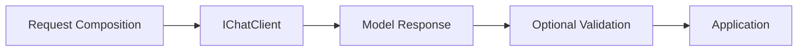

# Result validation

The response boundary is in Core's request execution, after Microsoft's structured-output response and before a conversation commits. Context catalogs and prompt rendering do not evaluate domain rules. Existing SDK-returning send methods remain compatible and make no domain-validation claim.

`AiResultContract<T>` is an immutable ordered selection of required validator types and optional application-supplied reference strings. `IAiResultValidator<T>` accepts a typed candidate, limited `AiValidationContext` metadata and cancellation. `AiValidationPipeline` resolves ordinary registered .NET services and executes them sequentially in selection order, preserving every finding. No model retry or repair occurs. Each validator returns Valid, Invalid or Unverifiable; NotValidated is reserved for an empty pipeline. Invalid takes precedence over Unverifiable, which takes precedence over Valid. Empty contracts yield NotValidated.

Structural parsing and domain validation are separate. The explicit result API retains raw text, reports structural failure separately, and skips domain validators when no non-null typed candidate exists. Required JSON members and types are enforced by the supplied System.Text.Json contract; this is not full JSON Schema validation. Domain status cannot be Valid without a typed candidate. Structural failures with requested validators leave domain validation Unverifiable; without validators it remains NotValidated. `AiValidatedResult<T>` exposes the candidate explicitly and offers a guarded accessor for results satisfying configured checks. Passing checks does not establish universal truth or authorize a business action.

Provider, DI, infrastructure, programming and cancellation exceptions propagate; they are never converted to domain findings. Only response deserialization failures are structural failures. Legitimately missing evidence is an explicit Unverifiable finding from application code. Cancellation is checked before/after provider execution and each validator. Validators must not mutate candidates or reference data and must respect their DI lifetimes and concurrency requirements.

Use `AddAiResultValidator<T, TValidator>()` and resolve the scoped `AiValidationPipeline` from the application's scope. Pass that pipeline to `Expect<T>(pipeline: pipeline)` or conversation `SendValidatedAsync`. No custom contract or service provider is needed for unvalidated `Expect<T>()`. Contracts can be reused; typed request selections return new builders. Validator resolution happens before model execution. Contexts do not retain scoped services.

Validators receive configuration IDs, a per-execution correlation ID and explicitly supplied reference strings. Prompt bodies and conversation history are not supplied automatically; the candidate is passed separately. Application-supplied reference strings, identifiers and candidates may themselves contain sensitive data and are not automatically redacted. Callers receive the immutable request snapshot alongside the outcome for deliberate inspection.

The result envelope retains raw response text, not provider-specific SDK metadata or usage. Existing SDK-returning sends remain available; applications can also invoke the public pipeline on their typed results. SDK Result handles parsing. JsonException raised while reading Result becomes a structural diagnostic, including one raised by a converter. InvalidOperationException is translated only when it originates in the SDK Result getter (null/missing wrapper); other converter exceptions propagate. This filter is specific to the installed SDK and regression-tested. Custom JSON options must supply a TypeInfoResolver (copy JsonSerializerOptions.Default for reflection-based defaults). JSON required members must be declared explicitly; arbitrary domain format or arithmetic constraints belong in validators.

Conversations use their existing operation gate throughout execution and validation. Valid and NotValidated typed responses commit detached text and immutable validation findings to the turn; typed objects and mutable SDK responses are not retained. Structural failures, Invalid and Unverifiable responses return to the caller with the attempted request but do not change history. Errors and cancellation also leave state unchanged. Rejected attempts have no committed turn ID and are not replayable, including through explicit sharing. Applications can retain returned outcomes for their own audit requirements. Domain/role changes and history selection remain independent of validators.

Definition snapshots contain declarative prompt content, not result contracts, validator selections or DI registrations. Applying or refreshing definitions cannot install validators or change a selected AiResultContract<T>. Expect captures its request before execution; later definition updates cannot replace that request's content. See [Definition serialization and updates](DefinitionSerialization.md).
